# Open-AutoGLM-GUI (鱼塘管理器)

<div align="center">

**下一代多设备 Android AI Phone Agent 集中管理与可视化自动化工作台**

[](https://www.python.org/downloads/)
[](https://fastapi.tiangolo.com)
[](https://github.com/Genymobile/scrcpy)
[](LICENSE)

[English README](README_EN.md) · [痛点与特性](#-为什么选择本项目解决的核心痛点) · [主界面逐一详解](#-系统核心主界面逐一详解真实运行数据) · [快速上手](#-快速上手) · [常见问题](#-常见问题与排查)

</div>

---

## 💡 为什么选择本项目？解决的核心痛点

传统的手机自动化（如 Appium、Airtest、按键精灵）通常依赖繁琐的控件选择器或写死坐标，App 稍微改版流程即彻底失效；而单纯的纯文本 AI 往往缺乏真实交互界面，每次执行重度依赖逐帧推理，既昂贵又耗时。

**Open-AutoGLM-GUI** 专为解决多设备实机环境下的**「难维护、难复用、缺管控、难远程」**四大痛点而生：

| 传统手机自动化与脚本 | 纯学术 Agent / 命令行工具 | **Open-AutoGLM-GUI (鱼塘管理器)** |
|---|---|---|
| **控件变动频繁，维护成本高**<br>App UI 迭代后选择器失效，需重写代码 | **黑盒运行，无可视化界面**<br>控制台文字滚动，中途卡死无感知 | **多模态视觉 Agent + 实时可视化**<br>大模型直接“看懂”界面语义，自适应 UI 变化；右下角悬浮窗毫秒级实时推流。 |
| **规则硬编码，缺乏泛化能力**<br>只能按死步骤执行，无法应对弹窗与变化 | **纯 AI 逐帧推理，耗时且昂贵**<br>每次重复任务都消耗大量 Token，耗时几分钟 | **示教录制 ➔ 配方沉淀 ➔ 参数化重放**<br>一次示教沉淀为可复用配方，支持 `{keyword}` 动态参数，兼具 AI 的泛化与脚本的极速。 |
| **遇到验证码/支付直接报错中断**<br>缺乏人机协作机制 | **无接管路径**<br>遇到敏感权限只能抛异常退出 | **人工接管 (Take-over) & 智能后验**<br>遇到人脸/支付主动暂停并提醒接管；任务执行完毕自动结合历史上下文智能校验结果。 |
| **仅限单机 USB，多设备管理割裂**<br>多部设备来回插拔，切换繁琐 | **无法外网远程协同**<br>离开局域网便无法控制 | **集中群控 + 一键公网穿透 + Telegram 联动**<br>一键平滑切换所有设备；内置 Cloudflare Tunnel 零配置公网访问；Telegram 远程随时下发。 |

---

## 🖥️ 系统核心主界面逐一详解（真实运行数据）

本项目提供开箱即用的一站式 Web 管理工作台，以下为系统 11 大核心功能页面的真实截图与功能介绍：

### 01. 💬 任务对话与执行工作台 (Chat Workbench)

智能体任务的调度核心。支持用自然语言直接向指定设备下发指令，完整展现多模态大模型的思考推理链（CoT）、上下文压缩与执行日志，右下角内嵌低延迟悬浮手机窗。

- **自然语言指令下发**：直接输入“在美团搜索附近的火锅店并按评分排序”即可自主拆解执行。
- **思考链 (CoT) 过程透明**：每一步的意图拆解、识别坐标与执行结果实时可见。
- **右下角悬浮手机窗**：毫秒级 Scrcpy 视频流推流，集成「实（实时控制）/ 录（示教录制）/ 回（动作回放）」三大统一入口，键鼠按键直接透传。

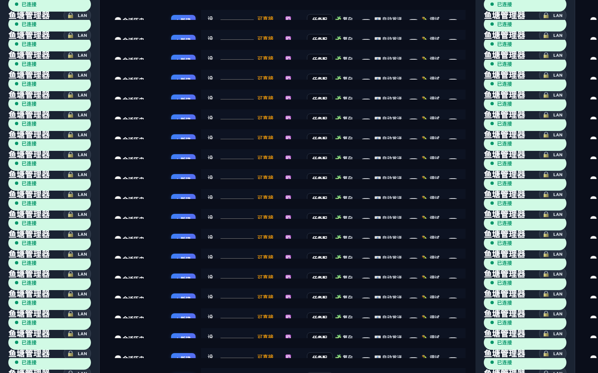

---

### 02. 📱 设备管理中心 (Device Center)

管理全部物理连接与无线配对的 Android 设备。提供设备状态卡片、网络信息、锁屏 PIN 码管理与无线调试配对向导。

- **设备状态卡片**：展示设备型号（如 MEIZU_20）、状态（connected/offline）、连接类型（USB/WiFi）、屏幕分辨率与实时电量。
- **无线配对向导**：支持输入局域网 `IP:Port` 快速无线连接，或通过配对码进行 Android 11+ 无线调试配对。
- **设备安全管理**：配置锁屏 PIN 码，自动化启动时自动执行唤醒与点亮解锁时序。

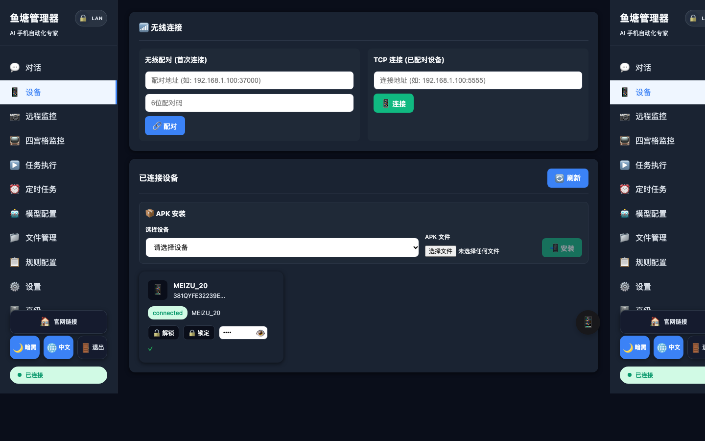

---

### 03. 📷 设备运行监控看板 (Device Monitor)

针对受控设备与运行环境的实时健康度监控。

- **性能状态追踪**：监控设备屏幕实时刷新帧率、后台自动化服务状态。
- **设备硬件指标**：清晰查看设备 CPU 占用、内存消耗趋势、电池温度与供电状态。
- **异常自愈检测**：设备异常掉线或 ADB 链路阻塞时即时感知并告警。

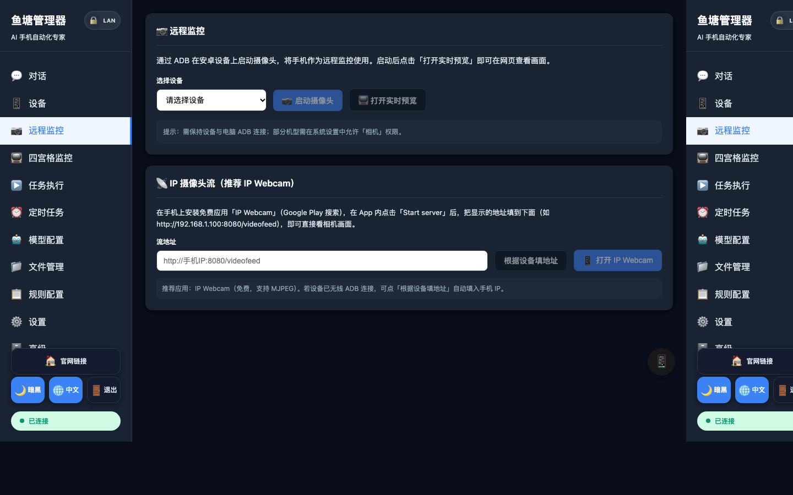

---

### 04. 📺 多设备实时视频矩阵墙 (Device Matrix Grid)

多机并发与群控集中观察大屏。

- **多机位平铺观察**：将所有在线受控设备的实时屏幕以网格画幅形式集中平铺展现。
- **批量并发监控**：多台设备同时执行不同自动化配方或批量任务时，一屏尽收眼底。
- **一键主控切换**：点击任意设备卡片即可快速呼出控制通道或切换为主操作设备。

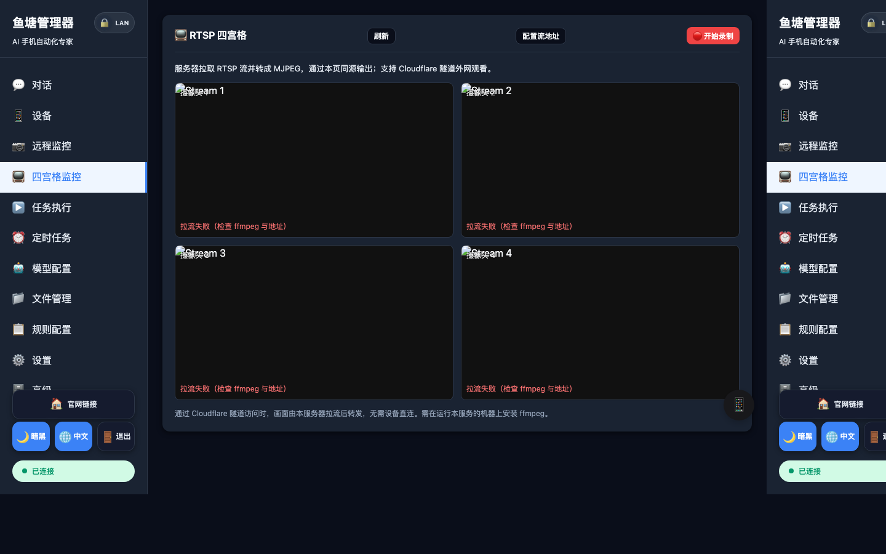

---

### 05. ▶️ 任务管理与执行历史 (Task Management & History)

全量任务的历史审计与可追溯性中心。

- **任务来源标签清晰分类**：准确区分手动下发 (`manual`)、定时排期 (`scheduled`)、事件触发 (`trigger`)、试运行 (`trial`)。
- **执行指标统计**：查看每项任务的开始时间、运行时长、执行步数及最终状态（已完成/接管中/失败）。
- **步骤上下文追溯**：点击任务可直接查看完整执行流程，包括每一步的截图记录与模型决策入参。

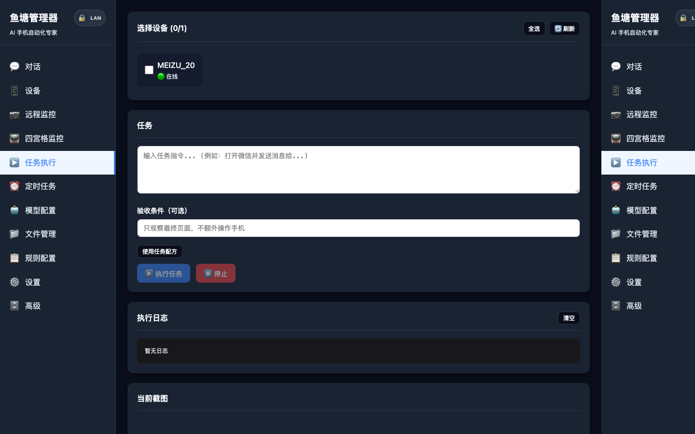

---

### 06. ⏰ 定时任务与自动化配方工作台 (Automation & Scheduler)

从“纯大模型探索”升级为“工业级自动化”的关键基石。

- **示教录制 (Demonstration)**：在手机预览窗上直接手工操作一次，系统自动捕获交互并转化为可编辑的步骤流。
- **参数化配方库 (Recipes)**：将成功步骤固化为配方，支持 `{keyword}`、`{city}` 等动态参数注入，大幅减少 Token 消耗。
- **定时与条件触发**：支持基于时间（Cron / 周期）与基于系统状态（设备上线、电量充饱、前序配方成功）自动排期触发。

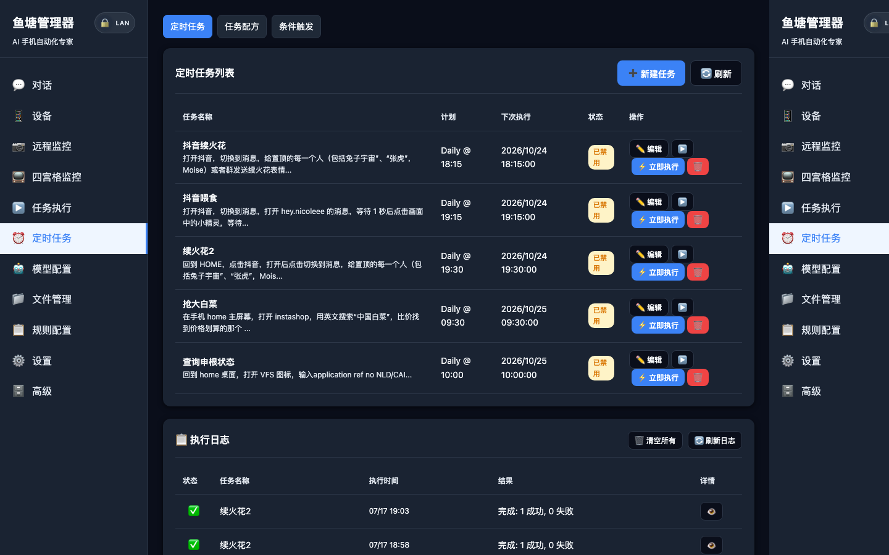

---

### 07. 🤖 多模型服务配置中心 (Model Services)

多源 AI 模型的集中管理与连接测试中枢。

- **多提供商全面支持**：开箱支持智谱 BigModel（原生云端推荐）、OpenAI 兼容接口、本地私有化 vLLM、Ollama 等。
- **模型参数可视化配置**：直观调整 Temperature、Top_p、Max Steps（步数上限）、系统 Prompt 预设。
- **连通性一键测试**：提供 API 连通性测试按钮，快速检测接口延迟与密钥有效性。

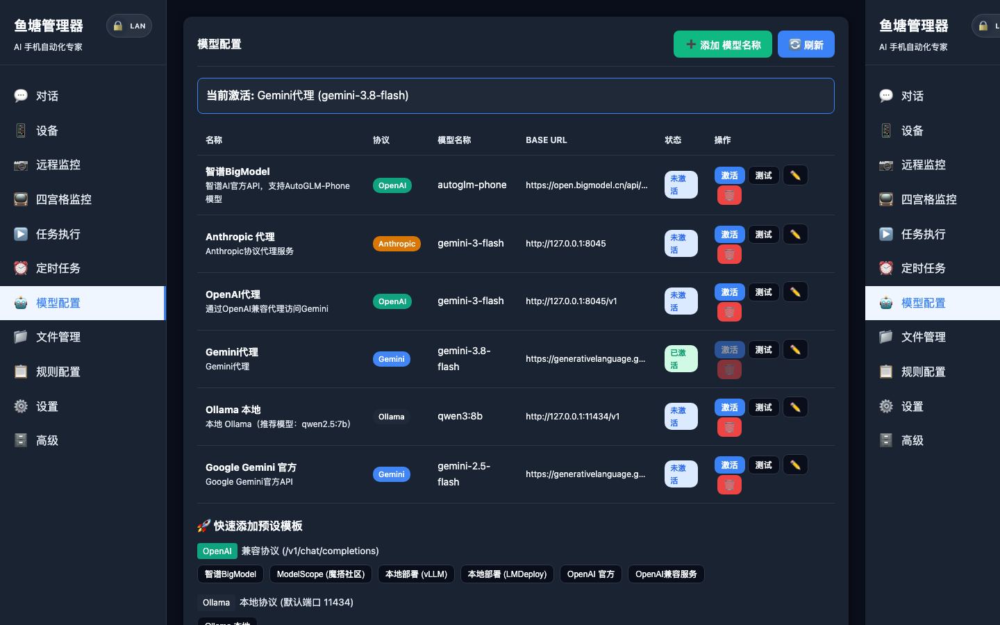

---

### 08. 📁 文件存储与多媒体管理 (File Storage)

自动化执行与录制过程中沉淀的多媒体数字资产归档。

- **截图流水记录**：按任务和时间分类浏览所有历史截图证据。
- **操作录像存储**：示教录制与执行过程中生成的视频片段查看与下载。
- **配置导出与导入**：支持将自动化配方、规则配置一键打包导出并迁移到其他实例。

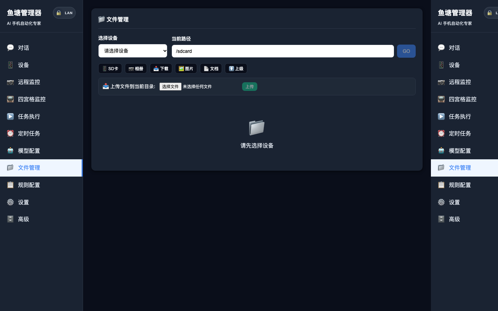

---

### 09. 📋 规则引擎与应用包名映射 (Rules Engine)

保障 Agent 决策高准确度与安全边界的先验知识库。

- **智能应用包名映射**：内置 50+ 款主流 Android 社交、电商、外卖、出行应用的包名与主 Activity 映射表。
- **动作规则与黑白名单**：支持规则优先级覆盖，限制危险操作动作（如禁止随机点击支付确认）。
- **自定义系统提示词 (Prompt)**：可根据业务实际需求注入定制先验规则与领域规范。

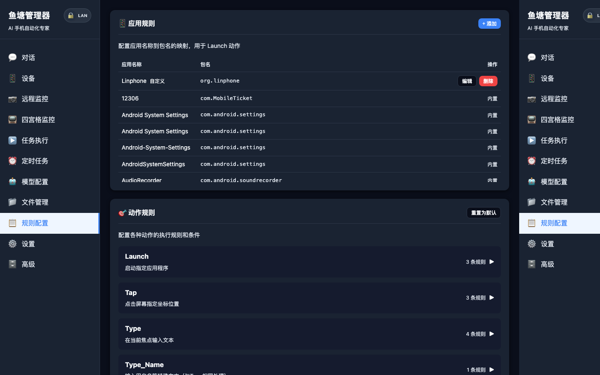

---

### 10. ⚙️ 系统配置与远程通道集成 (System Settings)

打通外网访问、多端提醒与系统级安全配置。

- **Cloudflare Tunnel 一键公网访问**：在 Web 界面一键切换为 `Public`，即刻生成安全的临时公网链接，免公网 IP 和端口转发。
- **Telegram 远程机器人**：绑定 Bot Token 与 Chat ID，随时随地在 Telegram 中发送任务指令与接收截图。
- **SMTP 邮件图文通知**：任务完成或发生异常时自动生成包含图文日志的邮件报告推送给管理员。

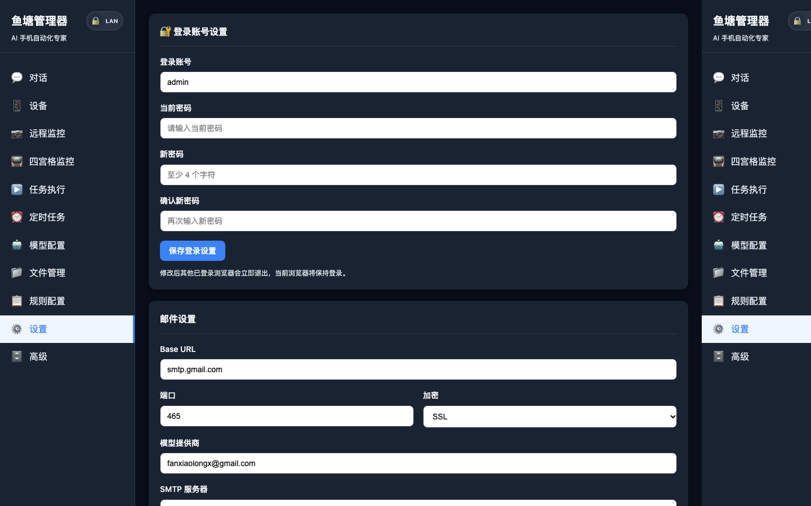

---

### 11. 🗄️ 数据库管理与历史记录审计 (Database Management)

内置轻量级 SQLite 可视化管理视图。

- **会话表 (Sessions)**：查看所有历史会话的创建时间、最后更新时序与绑定的设备 ID。
- **消息表 (Messages)**：查看对话记录、用户指令与 AI 状态持久化详情。
- **任务审计数据**：底层任务执行状态与事件游标直观审查，方便运维与调试。

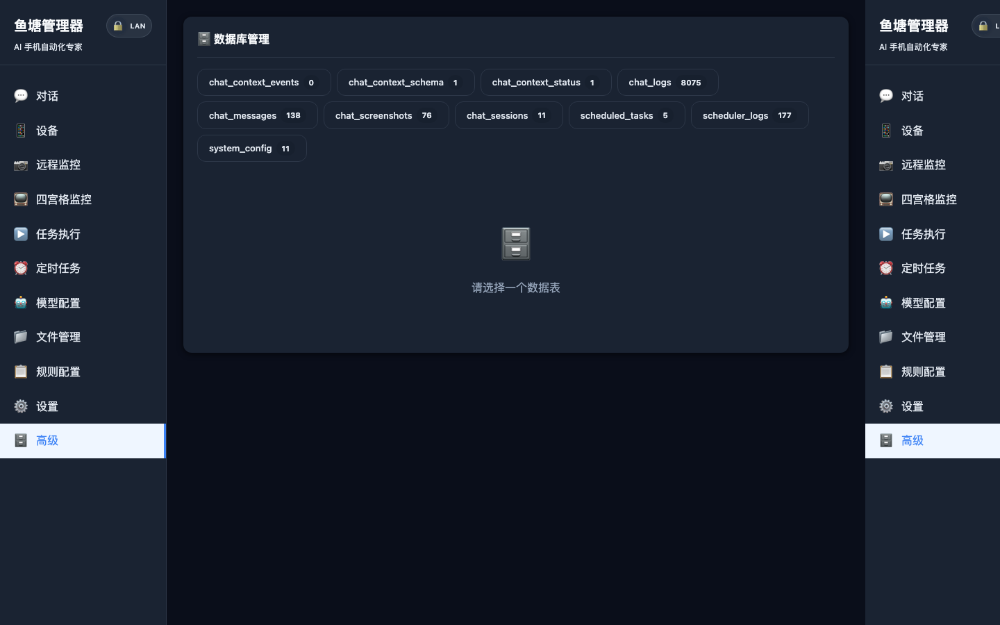

---

## ⚡ 快速上手

### 1. 环境准备

- **操作系统**：macOS / Linux / Windows
- **Python**：3.10+
- **ADB 工具**：
  ```bash
  # macOS
  brew install android-platform-tools

  # Ubuntu / Debian
  sudo apt install adb

  # Windows
  # 下载 Android SDK Platform Tools 并将目录加入系统 PATH 环境变量
  ```
- **Android 手机设置**：
  1. 进入 **设置 → 关于手机**，连续点击“版本号” 7 次开启开发者选项。
  2. 进入 **系统 → 开发者选项**，开启 **USB 调试**。
  3. *(重要)* 若为国内品牌机型（小米/vivo/OPPO），请同步开启 **USB 调试（安全设置）**（允许模拟点击与输入）。

### 2. 三步启动工作台

```bash
# 1. 克隆项目并安装依赖
git clone https://github.com/fanxiaolongx-max/Open-AutoGLM-GUI.git
cd Open-AutoGLM-GUI
pip install -r requirements.txt

# 2. 连接手机并确认连接正常
adb devices
# 正确输出示例：
# List of devices attached
# 381QYFE32239E    device

# 3. 启动 Web 工作台
python run_web.py
```

启动完成后，打开浏览器访问 **`http://localhost:8080`** 即可进入图形化工作台。

---

## 🤖 模型服务接入指南

系统支持多种主流模型接入方式，启动后在 Web 界面 **「模型服务」** 菜单中可视化配置即可：

### 方式一：智谱 BigModel（云端原生推荐）
无需本地 GPU 算力，开箱即用：
1. 访问 [智谱开放平台](https://open.bigmodel.cn/) 获取 API Key。
2. 在 Web 端或启动配置中填入：
   - **Base URL**: `https://open.bigmodel.cn/api/paas/v4`
   - **Model**: `autoglm-phone`
   - **API Key**: `YOUR_API_KEY`

### 方式二：OpenAI 兼容接口 / 视觉网关
支持任何具备多模态视觉输入能力的 OpenAI 兼容网关：
- **Base URL**: `https://your-api-gateway/v1`
- **Model**: `gpt-4o` / 自定义多模态模型名
- **API Key**: `YOUR_TOKEN`

### 方式三：本地部署（vLLM / 私有化）
适合拥有 24GB+ 显存 GPU 的私有化部署环境：
```bash
python3 -m vllm.entrypoints.openai.api_server \
  --served-model-name autoglm-phone-9b \
  --model zai-org/AutoGLM-Phone-9B \
  --port 8000
```
Web 配置对应连接 `http://localhost:8000/v1`。

---

## 📁 项目架构与目录结构

```
Open-AutoGLM-GUI/
├── run_web.py                  # Web 工作台入口
├── main.py                     # 命令行 CLI 入口
├── phone_agent/                # Agent 智能体核心引擎
│   ├── agent.py                # 决策主循环、上下文压缩与智能后验
│   ├── actions/                # ADB / HDC 动作执行器与输入注入
│   ├── adb/                    # ADB 连接管理与屏幕采集
│   ├── config/                 # 默认应用映射与系统提示词
│   └── model/                  # 多模态大模型客户端适配器
├── web_app/                    # Web 后端与交互服务 (FastAPI)
│   ├── main.py                 # FastAPI 应用入口与中间件
│   ├── routers/                # 业务路由 (chat, devices, automation, scrcpy 等)
│   ├── services/               # 业务引擎 (配方运行时、Scrcpy 推流、Telegram Bot、调度器)
│   ├── models/                 # SQLite 数据持久化与 Pydantic 规范
│   └── static/                 # 响应式前端工作台（Vue 3 单页架构）
├── resources/                  # 静态多媒体资源
│   └── screenshots/            # 系统 11 大核心界面真实高清截图
└── docs/                       # 架构设计与自动化工作台开发手册
```

---

## ❓ 常见问题与排查

<details>
<summary><strong>Q1: <code>adb devices</code> 显示 unauthorized 或无法识别设备？</strong></summary>

- 拔掉数据线重新插入，观察手机屏幕是否弹出“允许 USB 调试”授权框，勾选“始终允许”后确认。
- 重启 ADB 守护进程：
  ```bash
  adb kill-server && adb start-server
  ```
- 确认数据线支持数据传输（避免仅充电线）。
</details>

<details>
<summary><strong>Q2: 能够打开 App，但点击/滑动没有任何反应？</strong></summary>

- 国内定制安卓系统（如 MIUI/HyperOS、ColorOS、OriginOS）有额外的安全防护机制。
- 请进入 **开发者选项**，开启 **「USB 调试（安全设置）」** 或 **「禁止权限监控」**，允许通过 USB 模拟屏幕点击。
</details>

<details>
<summary><strong>Q3: 文本输入无法输入中文或显示乱码？</strong></summary>

- 系统默认推荐使用 [ADBKeyBoard](https://github.com/senzhk/ADBKeyBoard/blob/master/ADBKeyboard.apk)。
- 将手机当前默认输入法切换为 ADB Keyboard 即可实现全量中文字符精准键入。
</details>

<details>
<summary><strong>Q4: 关闭浏览器后，自动化任务或定时计划还会继续执行吗？</strong></summary>

- **会继续执行**。任务调度、配方编排与设备控制均在 Python 后端常驻服务内驱动，前端页面仅作为展示终端。关闭页面不会影响正在执行的任务。
</details>

---

## 📜 致谢与开源协议

- 本项目基于 [Apache 2.0](LICENSE) 协议开源。
- 感谢 [AutoGLM](https://github.com/zai-org/AutoGLM) 与开源多模态智能体研究社区为 GUI 视觉定位与交互决策提供的坚实探索基础。

> ⚠️ **合规提示**：本项目仅供技术探索、研发辅助及个人自动化用途。使用时请严格遵守各平台服务协议与法律法规，禁止用于非法抓取、对抗系统或侵害他人合法权益的行为。
