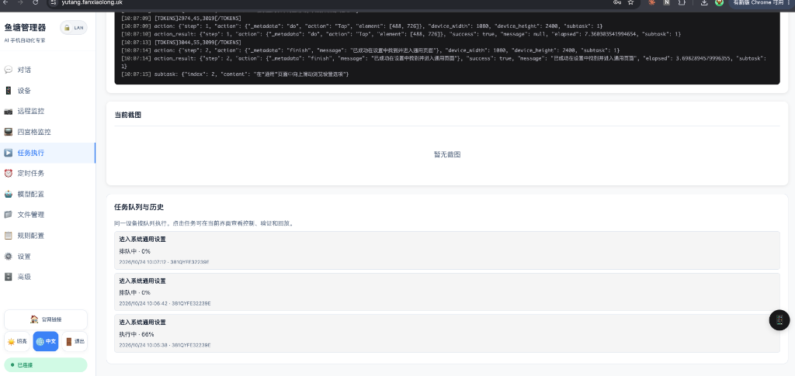
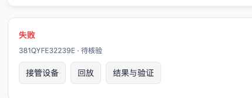
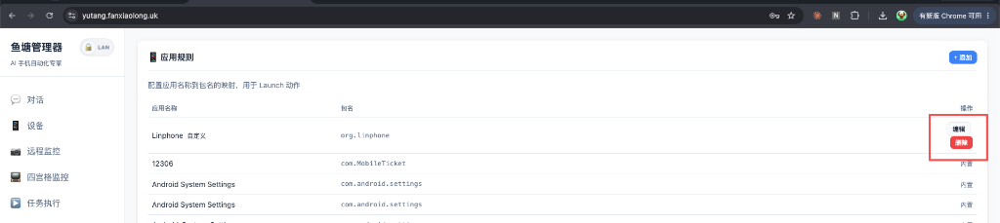

# Open-AutoGLM-GUI (鱼塘管理器)

<div align="center">

**下一代多设备 Android AI Phone Agent 集中管理与可视化自动化工作台**

[](https://www.python.org/downloads/)
[](https://fastapi.tiangolo.com)
[](https://github.com/Genymobile/scrcpy)
[](LICENSE)

[English README](README_EN.md) · [核心特性](#-核心功能速览) · [解决的痛点](#-为什么选择本项目解决的核心痛点) · [快速上手](#-快速上手) · [常见问题](#-常见问题与排查)

</div>

---

## 💡 为什么选择本项目？解决的核心痛点

传统的手机自动化（如 Appium、Airtest、按键精灵）通常依赖繁琐的控件选择器或写死坐标，App 稍微改版流程即彻底失效；而单纯的纯文本 AI 往往缺乏真实交互界面，每次执行重度依赖逐帧推理，既昂贵又耗时。

**Open-AutoGLM-GUI** 专为解决多设备实机环境下的**「难维护、难复用、缺管控、难远程」**四大痛点而生：

| 传统手机自动化与纯脚本 | 纯学术 Agent / 命令行工具 | **Open-AutoGLM-GUI (鱼塘管理器)** |
|---|---|---|
| **控件经常变动，维护成本极高**<br>App UI 迭代后选择器失效，需重写代码 | **黑盒运行，无可视化**<br>控制台文字滚动，中途卡死无感知 | **多模态视觉 Agent + 实时可视化**<br>大模型直接“看懂”界面语义，自适应 UI 变化；右下角悬浮窗毫秒级实时流。 |
| **规则硬编码，缺乏泛化能力**<br>只能按死步骤执行，无法应对弹窗与变化 | **纯 AI 决策，耗时且昂贵**<br>每次重复任务都消耗大量 Token，耗时几分钟 | **示教录制 ➔ 配方沉淀 ➔ 参数化重放**<br>一次示教沉淀为可复用配方，支持 `{keyword}` 动态参数，兼具 AI 的泛化与脚本的极速。 |
| **遇到验证码/支付直接报错中断**<br>缺乏人机协作机制 | **无接管路径**<br>遇到敏感权限只能抛异常退出 | **人工接管 (Take-over) & 智能后验**<br>遇到人脸/支付主动暂停并提醒接管；任务执行完毕自动结合历史上下文智能校验结果。 |
| **仅限单机 USB，多设备切换混乱**<br>多部设备来回插拔，管理繁琐 | **无法外网远程协同**<br>离开局域网便无法控制 | **集中管控 + 一键公网穿透 + Telegram 联动**<br>一键平滑切换所有设备；内置 Cloudflare Tunnel 零配置公网访问；Telegram 远程随时下发。 |

---

## 🌟 核心功能速览

### 1. 📱 任务执行与多设备对话中心
用自然语言描述需求（如 *“打开美团搜索附近的火锅店并按评分排序”*、*“在小红书收藏第三篇露营攻略”*），多模态 AI 智能体直接基于视觉理解界面，自主拆解并执行 Tap、Type、Swipe、Launch 等操作。

- **思考链 (CoT) 过程透明**：每一步的意图拆解、识别坐标与执行结果实时可见。
- **上下文智能压缩 (Context Compaction)**：自动裁剪冗余历史步骤，降低 50%+ 显存与 Token 开销。
- **智能后验校验**：任务完成自动后验界面状态，容忍滚动后视图，杜绝误判与假死。
- **任务历史与标签追溯**：清晰标记手动（manual）、计划（scheduled）、触发（trigger）、试运行（trial）不同来源。

<div align="center">
  
  <p><em>图 1：任务执行中心（多设备选择、自然语言下发、思考链可视化与任务日志）</em></p>
</div>

---

### 2. 🧪 自动化工作台：示教录制与配方沉淀
不仅能依赖大模型实时决策，更提供工业级**自动化工程沉淀能力**：

- **示教录制 (Demonstration)**：直接在悬浮手机窗上操作，系统自动捕获交互并转化为可编辑的步骤流。
- **配方化沉淀 (Recipes)**：将成功任务一键提取为结构化配方，支持 `{keyword}`、`{city}` 等参数模板，随取随用。
- **条件触发与定时计划**：支持基于时间（Cron / 周期）与基于系统状态（设备上线、电量充饱、前序配方成功）自动排期触发。
- **持久化后台运行**：由后端异步调度引擎驱动，关闭浏览器仍稳定运行，不漏跑、不重复。

<div align="center">
  
  <p><em>图 2：自动化工作台（参数化配方库、步骤编排与一键试运行）</em></p>
</div>

---

### 3. 🎮 悬浮手机窗与毫秒级直通控制
告别多设备分散乱象，所有设备交互收拢于统一的悬浮手机预览窗：

- **毫秒级低延迟视频流**：基于 `scrcpy-server + ffmpeg` WebSocket 视频流直出，支持自适应码率与多设备平滑热切换。
- **触控与键盘直通**：鼠标点击、长按、滑动即时映射；PC 键盘按键与中文输入全局透传。
- **统一工具箱**：窗内集成 **「实（实时控制）/ 录（示教录制）/ 回（动作回放）」** 极简入口，避免界面到处散落重复按钮。
- **多设备矩阵墙 (Grid)**：支持网格平铺查看所有已连接设备屏幕与在线状态。

---

### 4. 🎯 规则引擎与系统配置
提供高度可定制的规则与策略系统，保障 Agent 执行的稳定与合规：

- **智能应用映射**：内置 50+ 款主流 Android 社交、电商、外卖、出行应用的包名与主 Activity。
- **自定义动作规则**：支持规则优先级覆盖、动作白名单/黑名单限制。
- **自定义系统提示词 (Prompt)**：可根据业务需要注入定制化的先验规则与业务约束。

<div align="center">
  
  <p><em>图 3：规则引擎与应用映射管理</em></p>
</div>

---

### 5. 🌐 远程协作与通知生态
- **Cloudflare Tunnel 一键公网访问**：内置隧道支持，在 Web 侧边栏一键切换 `Public`，即刻生成临时公网访问链接，支持自动访问令牌认证，无需公网 IP 和端口转发。
- **Telegram 远程控制机器人**：绑定后可在 Telegram 中直接发送文字指令下发任务、查看手机截屏、管理定时排期。
- **邮件图文报告**：长周期或无人值守任务完成后，自动生成包含执行耗时、步骤日志和界面截图的完整图文邮件通知。

---

## ⚡ 快速上手

### 1. 环境准备

- **操作系统**：macOS / Linux / Windows
- **Python**：3.10+
- **ADB 工具**：
  ```bash
  # macOS
  brew install android-platform-tools

  # Ubuntu / Debian
  sudo apt install adb

  # Windows
  # 下载 Android SDK Platform Tools 并加入 PATH 环境变量
  ```
- **Android 手机设置**：
  1. 进入 **设置 → 关于手机**，连续点击“版本号” 7 次开启开发者选项。
  2. 进入 **系统 → 开发者选项**，开启 **USB 调试**。
  3. *(重要)* 若为小米/vivo/OPPO 等机型，请同步开启 **USB 调试（安全设置）**（允许模拟点击）。

### 2. 三步启动工作台

```bash
# 1. 克隆项目并安装依赖
git clone https://github.com/zai-org/Open-AutoGLM.git
cd Open-AutoGLM
pip install -r requirements.txt

# 2. 连接手机并确认连接正常
adb devices
# 输出示例：
# List of devices attached
# 127.0.0.1:5555    device

# 3. 启动 Web 工作台
python run_web.py
```

启动完成后，打开浏览器访问 **`http://localhost:8080`** 即可进入图形化工作台。

---

## 🤖 模型服务配置

系统支持多种主流模型接入方式，可在 Web 界面 **「模型服务」** 菜单中可视化配置与测试：

### 方式一：智谱 BigModel（云端原生推荐）
无需本地 GPU，开箱即用：
1. 访问 [智谱开放平台](https://open.bigmodel.cn/) 获取 API Key。
2. 在 Web 端或启动命令中配置：
   - **Base URL**: `https://open.bigmodel.cn/api/paas/v4`
   - **Model**: `autoglm-phone`
   - **API Key**: `YOUR_API_KEY`

### 方式二：OpenAI 兼容接口 / 视觉大模型网关
支持任何具备视觉输入能力的 OpenAI 兼容接口（如 GPT-4o、Claude 代理网关、Gemini 代理）：
- **Base URL**: `https://your-api-gateway/v1`
- **Model**: `gpt-4o` / 自定义模型名
- **API Key**: `your-token`

### 方式三：本地部署（vLLM / 私有化）
适合拥有 24GB+ 显存 GPU 的私有化部署环境：
```bash
python3 -m vllm.entrypoints.openai.api_server \
  --served-model-name autoglm-phone-9b \
  --model zai-org/AutoGLM-Phone-9B \
  --port 8000
```
Web 配置对应连接 `http://localhost:8000/v1`。

---

## 🛠️ CLI 命令行模式（脚本与自动化集成）

除 Web 工作台外，系统完整保留轻量 CLI 模式，便于集成到外部流水线中：

```bash
# 单任务直接执行
python main.py --apikey sk-xxxxx "打开小红书搜索露营"

# 指定设备与步数上限
python main.py --device-id 192.168.1.100:5555 --max-steps 30 "打开美团点咖啡"

# 列出已支持的应用包名
python main.py --list-apps
```

---

## 📁 项目结构

```
Open-AutoGLM/
├── run_web.py                  # Web 工作台入口
├── main.py                     # 命令行 CLI 入口
├── phone_agent/                # Agent 智能体核心引擎
│   ├── agent.py                # 决策与主循环（含上下文压缩与后验）
│   ├── actions/                # ADB / HDC 动作执行器
│   ├── adb/                    # ADB 连接与屏幕捕获
│   ├── config/                 # 默认应用映射与 Prompts
│   └── model/                  # 多模态模型客户端适配器
├── web_app/                    # Web 后端与交互服务 (FastAPI)
│   ├── main.py                 # FastAPI 应用主路由与中间件
│   ├── routers/                # 业务路由 (chat, devices, automation, scrcpy 等)
│   ├── services/               # 业务引擎 (调度排期、配方运行时、Scrcpy 视频流、Telegram Bot)
│   ├── models/                 # SQLite 数据持久化与 Pydantic 规范
│   └── static/                 # 响应式前端页面与自动化工作台组件
└── docs/                       # 架构设计与自动化工作台说明文档
```

---

## ❓ 常见问题与排查

<details>
<summary><strong>Q1: <code>adb devices</code> 显示 unauthorized 或无法识别设备？</strong></summary>

- 拔掉数据线重新插入，观察手机屏幕是否弹出“允许 USB 调试”授权框，勾选“始终允许”后确认。
- 重启 ADB 守护进程：
  ```bash
  adb kill-server && adb start-server
  ```
- 确认数据线支持数据传输（避免仅充电线）。
</details>

<details>
<summary><strong>Q2: 能够打开 App，但点击/滑动没有任何反应？</strong></summary>

- 国内定制安卓系统（如 MIUI/HyperOS、ColorOS、OriginOS）有额外的安全防护机制。
- 请进入 **开发者选项**，开启 **「USB 调试（安全设置）」** 或 **「禁止权限监控」**，允许通过 USB 模拟屏幕点击。
</details>

<details>
<summary><strong>Q3: 文本输入无法输入中文或显示乱码？</strong></summary>

- 系统默认推荐使用 [ADBKeyBoard](https://github.com/senzhk/ADBKeyBoard/blob/master/ADBKeyboard.apk)。
- 将手机当前默认输入法切换为 ADB Keyboard 即可实现全量中文字符精准键入。
</details>

<details>
<summary><strong>Q4: 关闭浏览器后，自动化任务或定时计划还会继续执行吗？</strong></summary>

- **会继续执行**。任务调度、配方编排与设备控制均在 Python 后端常驻服务内驱动，前端页面仅作为展示终端。关闭页面不会影响正在执行的任务。
</details>

---

## 📜 致谢与开源协议

- 本项目基于 [Apache 2.0](LICENSE) 协议开源。
- 感谢 [AutoGLM](https://github.com/zai-org/AutoGLM) 与开源多模态智能体研究社区为 GUI 视觉定位与交互决策提供的坚实探索基础。

> ⚠️ **合规提示**：本项目仅供技术探索、研发辅助及个人自动化用途。使用时请严格遵守各平台服务协议与法律法规，禁止用于非法抓取、对抗系统或侵害他人合法权益的行为。
